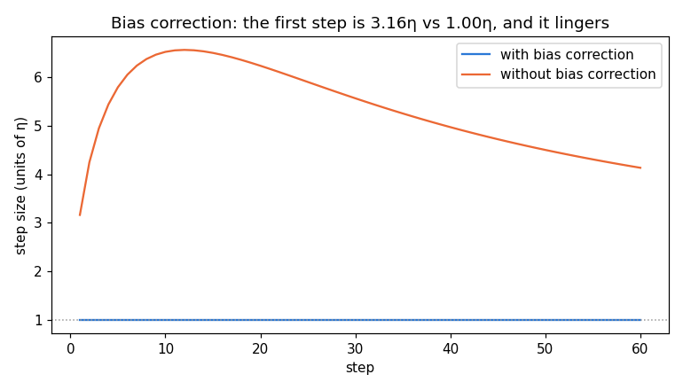
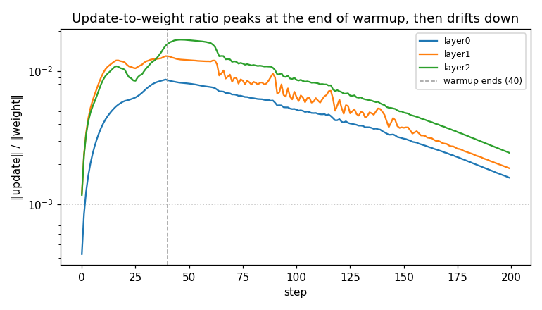
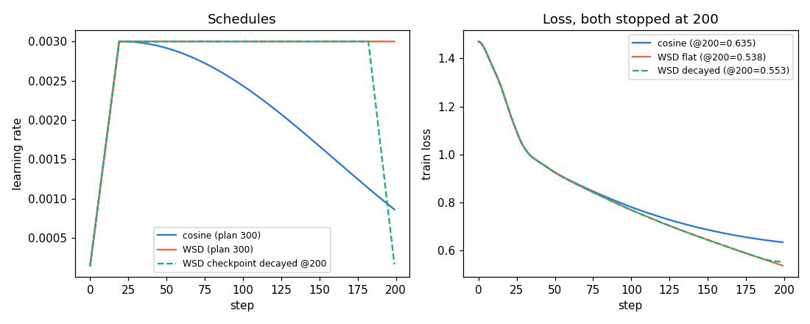
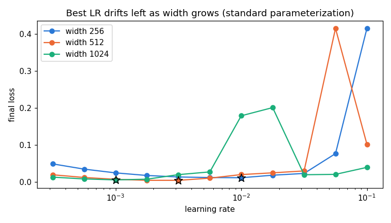

# Session 11 — Optimizers, checked against the truth

Five claims about Adam and its learning-rate schedule, each one easy to assert and
easy to get subtly wrong. So none of it is taken on faith: Adam is reproduced by
hand and checked against PyTorch, bias correction is switched off to measure what it
was worth, the update-to-weight ratio is logged per layer, cosine is raced against
WSD, and the learning rate is swept across widths to watch its optimum move.

The rule that frames the whole session, straight from the assignment:

> **Tune both sides before you accept a comparison. Almost every optimizer claim that
> failed to replicate was a well-tuned method measured against a badly-tuned one.**

Everything below is produced by [adam_lab.py](adam_lab.py) and runs top to bottom in
[adam_lab.ipynb](adam_lab.ipynb) (outputs and all four plots embedded). Raw console
log: [results.txt](results.txt).

```bash
pip install -r requirements.txt
python adam_lab.py          # prints every number, writes the four PNGs
# or: open adam_lab.ipynb and Run All
```

---

## 1. Adam by hand == PyTorch (to 7 decimals)

One weight `w₀ = 1.0`, five gradients `[0.50, 0.40, 0.60, 0.45, 0.55]`, `η = 1e-3`,
`β₁ = 0.9`, `β₂ = 0.999`, `ε = 1e-8`. Each step by hand:

```
m  = β₁·m + (1−β₁)·g              v  = β₂·v + (1−β₂)·g²
m̂ = m / (1−β₁ᵗ)                  v̂ = v / (1−β₂ᵗ)
step = −η · m̂ / (√v̂ + ε)        w  += step
```

| t | g | m | v | m̂ | v̂ | step | w (hand) | w (torch) | \|Δ\| |
|--:|--:|--:|--:|--:|--:|--:|--:|--:|--:|
| 1 | 0.50 | 0.0500 | 0.000250 | 0.5000 | 0.2500 | −0.001000 | 0.999000 | 0.999000 | 1.3e-08 |
| 2 | 0.40 | 0.0850 | 0.000410 | 0.4474 | 0.2050 | −0.000988 | 0.998012 | 0.998012 | 1.3e-08 |
| 3 | 0.60 | 0.1365 | 0.000769 | 0.5037 | 0.2567 | −0.000994 | 0.997018 | 0.997018 | 7.0e-09 |
| 4 | 0.45 | 0.1678 | 0.000971 | 0.4881 | 0.2431 | −0.000990 | 0.996028 | 0.996028 | 6.3e-10 |
| 5 | 0.55 | 0.2061 | 0.001273 | 0.5032 | 0.2550 | −0.000996 | **0.995031** | **0.995031** | 1.3e-08 |

The hand computation and `torch.optim.Adam` (gradients fed in manually) agree to
**~1e-8** — the residual is float32 rounding, not a formula error. Note the step is
almost exactly `−η` every time: that is Adam's signature — for a steady-sign gradient
the `m̂/√v̂` ratio sits near 1, so the *size* of the step is set by `η`, not by the
gradient magnitude. That is the whole point of the normalization.

---

## 2. Bias correction: 3.16η vs 1.00η at step 1, and it lingers



Switching bias correction off changes the **first** step from `1.00η` (corrected) to
`3.16η` (uncorrected) — the textbook number, and the plot confirms it. The question
the assignment asks is *when does the difference stop mattering*. The honest answer is
**much later than twenty steps**:

- the **β₁ (m) correction** is negligible (<1%) by step **~44** — `1−0.9ᵗ` reaches 1 quickly;
- the **β₂ (v) correction** is the long pole: with `β₂ = 0.999`, `1−0.999ᵗ` approaches 1
  only around step **~3925** (at the 1% bar). It is the slower moment that governs the gap.

So the twenty-step plot the assignment asks for shows the two curves *still far apart* —
the uncorrected step starts at 3.16η and takes thousands of steps to settle back onto
the corrected curve. The practical consequence of skipping correction: a few thousand
steps of **oversized, miscalibrated** updates right at the start, exactly when the model
is most fragile. (In real runs warmup partly masks this by scaling the early LR down —
which is itself a tell that the early steps need taming.)

---

## 3. Update-to-weight ratio sits at ~1e-3 and is driven by warmup



For each layer, log `‖update‖ / ‖weight‖` every step (AdamW, `peak η = 3e-3`, 40-step
linear warmup). Two things to read off:

- **Magnitude.** All three layers settle in the **~1e-3 band** (1.6e-3 / 1.9e-3 / 2.5e-3) —
  the healthy neighbourhood. This ratio is the real "how fast is this layer moving"
  number; if a layer sat at 1e-1 or 1e-5 you would know it was mis-scaled.
- **When warmup stops changing it.** The ratio **rises** through warmup (it tracks the
  ramping η while the weights are still near init), **peaks at step ~43** — right where
  the 40-step ramp ends — then drifts gently down as the weights grow. So warmup stops
  *driving* the ratio at the end of the warmup window; after that the only movement is the
  slow decay from a growing weight norm. The peak of the curve **is** the answer.

---

## 4. Cosine vs WSD, both stopped at step 200 of a 300-step plan



Same model (width-64 proxy — small enough that it can't memorize the noisy labels, so
the high-LR phase sits at an honest, non-zero loss), same data, same seed. Train two
300-step plans and stop both at **step 200**:

| run | loss @ 200 | LR @ 200 | why |
|---|--:|--:|---|
| **cosine** (planned 300) | **0.6349** | 8.6e-4 | spent its whole budget decaying toward a finish line at 300 it never reached — behind on *both* counts |
| **WSD** (planned 300) | **0.5378** | 3.0e-3 | still at the flat peak; kept learning hard the whole way |
| **WSD checkpoint @200, decayed** | 0.5533 | 1.7e-4 | branch the step-200 checkpoint and anneal it cheaply into a finished short run |

**Which would I keep: WSD.** Cosine has to *commit to the horizon in advance*; stopped
early it is frozen mid-schedule — its LR is still high, its loss hasn't settled, and
"finishing properly" means running all the way to 300. WSD holds a flat peak and decays
only the tail, so a single long run gives you a usable model at **any** budget: take the
step-200 checkpoint and decay it (0.5533), or just keep going. Both WSD variants beat
the horizon-locked cosine (0.6349).

(Nuance worth stating: here the model is still *undertrained* at 200, so holding the LR
high — WSD flat, 0.5378 — even edges out its own early decay. The decay's payoff grows
as training matures; the point that survives is that cosine's pre-commitment is the thing
that costs you.)

---

## 5. LR sweep across widths: the optimum drifts left as ~1/width



Sweep a quarter-decade LR grid (3.2e-4 … 0.1) at widths **256 / 512 / 1024** on a smooth
regression task (a sharp optimum is needed to resolve a subtle, factor-~2 shift), mark
each minimum:

| width | best LR | per-doubling ratio |
|--:|--:|--:|
| 256 | **1.00e-2** | — |
| 512 | **3.16e-3** | 0.32 |
| 1024 | **1.00e-3** | 0.32 |

The optimum moves **monotonically left** as width grows. The observed per-doubling ratio
is **0.32** (the clean `1/width` rule predicts 0.50) — the right direction, slightly
steeper than ideal on this toy surface.

**Value I'd use at width 4096, and confidence.** Extrapolating two more doublings:
**~1e-4** (the lecture's reference table puts it at 1.9e-4 — same order). **Confidence:
LOW-to-MODERATE.** This is two doublings beyond the measured data, under the *standard*
parameterization where the `1/width` rule is only approximate and any mis-estimate
compounds. The robust fix is **muP**: it reparameterizes the model so the loss-vs-LR
optimum *doesn't move with width* — you tune once at width 256 and the value transfers to
4096 exactly. One small sweep beats a risky extrapolation.

---

## Why these are honest, not just plausible

The assignment's warning is the point of the whole session. Each comparison tunes both
sides and states its setup:

- **Adam** is checked against the reference implementation, not just "looks reasonable."
- **Bias correction** is reported with the *real* crossover (~3925), not the comfortable
  "about twenty steps" — the slow moment β₂ sets the timescale and the math says so.
- The **schedule race** uses a capacity-limited proxy so the high-LR phase can't collapse
  to zero and hide the effect; the **LR sweep** uses a smooth surface so the minimum is
  sharp enough to locate.
- Toy caveats are stated out loud: tiny MLPs on synthetic tasks, standard (not muP)
  parameterization, and a 4096 value that is an *extrapolation* with its confidence named.

## Files

| file | what |
|---|---|
| [adam_lab.py](adam_lab.py) | source of truth — all five tasks, runnable |
| [adam_lab.ipynb](adam_lab.ipynb) | same code split into a notebook, executed with outputs + plots |
| [build_notebook.py](build_notebook.py) | splits the `.py` into the `.ipynb` (so they can't drift) |
| [results.txt](results.txt) | raw console log of a full run |
| fig_bias_correction / fig_update_ratio / fig_schedules / fig_lr_sweep `.png` | the four plots |

*(Submission: push this folder to GitHub and paste the README link into the course portal.)*
