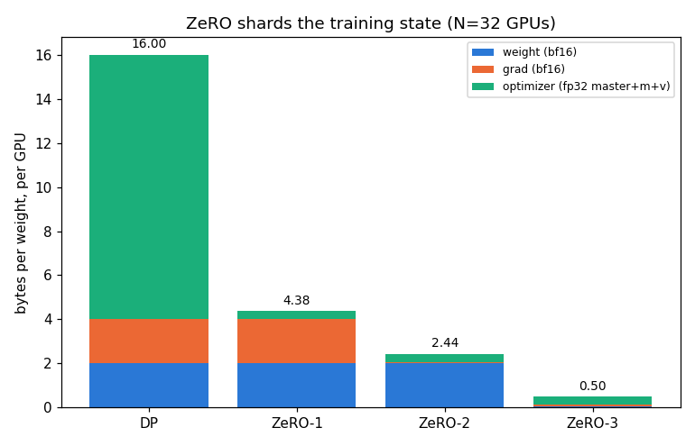
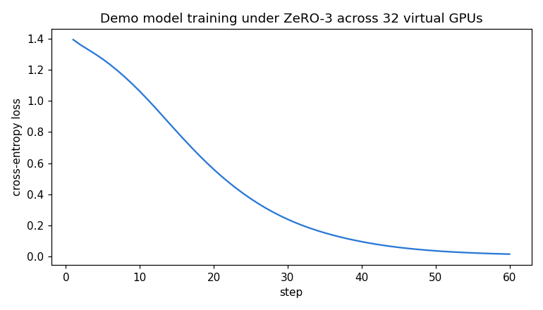
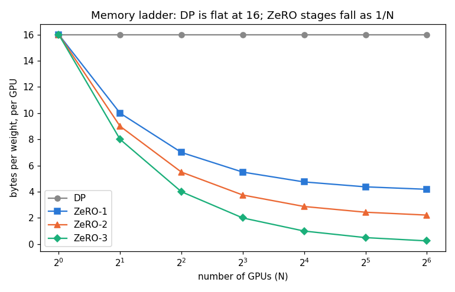

# Session 12 — ZeRO on 32 virtual GPUs, simulated and checked

The task: stand up **32 virtual GPUs**, run a demo model on them, simulate plain
data-parallel and **ZeRO stages 1 / 2 / 3**, and show how memory and computation change.

Everything here is produced by [zero_sim.py](zero_sim.py) and runs top to bottom in
[zero_sim.ipynb](zero_sim.ipynb) (outputs + all three plots embedded). Raw log:
[results.txt](results.txt).

```bash
pip install -r requirements.txt
python zero_sim.py        # prints every number, writes the three PNGs
# or open zero_sim.ipynb and Run All
```

---

## The one idea ZeRO is built on

Train a model in mixed precision with Adam and every weight drags **16 bytes of state**
behind it:

| what | precision | bytes/weight |
|---|---|--:|
| the weight the forward pass uses | bf16 | 2 |
| its gradient | bf16 | 2 |
| the fp32 "master" copy (so tiny updates don't vanish in bf16) | fp32 | 4 |
| Adam's first moment `m` (mean gradient) | fp32 | 4 |
| Adam's second moment `v` (mean gradient²) | fp32 | 4 |
| | | **16** |

Plain **data parallelism** puts a *full copy* of all 16 bytes on **every** GPU and just
averages gradients each step. That means adding GPUs buys you throughput but **not one
byte** of extra model capacity — all 32 GPUs hold the same 16·P bytes. For a 7B model
that's 112 GB of state, already past an 80 GB card, and data parallelism can't help.

**ZeRO's insight:** most of those 16 bytes are *redundant* across GPUs. If I have N GPUs,
I don't need N copies of the optimizer state — I can **split (shard) it** so each GPU keeps
only 1/N of it, and ship the missing pieces over the network exactly when they're needed.
Nothing about the math changes; only *who stores what* changes.

## The three stages — what each one shards

Start from DP (everything replicated) and shard one more thing at each stage:

| stage | weight | grad | optimizer state (master+m+v) | bytes/weight/GPU |
|---|:--:|:--:|:--:|---|
| **DP** | full | full | full | **16** |
| **ZeRO-1** | full | full | **sharded** | 4 + 12/N |
| **ZeRO-2** | full | **sharded** | sharded | 2 + 14/N |
| **ZeRO-3** | **sharded** | sharded | sharded | 16/N |

The arithmetic: the 2+2 bytes of weight+grad stay replicated until you shard them; the 12
bytes of optimizer state (4+4+4) get divided by N first because they're the biggest and the
easiest to split (only the optimizer touches them). My simulation **measures** these from the
actual tensors each rank holds — at N=8 they come out to the exact numbers from the lecture:

```
bytes/weight/GPU at N=8:   DP 16.00   ZeRO-1 5.50   ZeRO-2 3.75   ZeRO-3 2.00
```



At the assignment's **N=32**, measured directly from the per-rank tensors:
`DP 16.00 · ZeRO-1 4.375 · ZeRO-2 2.438 · ZeRO-3 0.500`.

## Why I trust the simulation: it's bitwise-correct

A memory table is only believable if the thing it describes actually *works*. So the
simulation isn't arithmetic — each of the 32 ranks is a real object holding real tensors
(only its shard), and the collectives are implemented explicitly. The decisive check:

> Run **one real optimizer step** under DP, ZeRO-1, ZeRO-2, ZeRO-3 and compare the
> reconstructed full weight. **All four are bitwise IDENTICAL (max |Δ| = 0.0).**

That is the whole point of ZeRO stated as a test: sharding redistributes *storage and
compute*, it does not change the result. If this passed by luck it would mean nothing, so I
also **train the demo model for 60 steps under full ZeRO-3 sharding** — all-gather the weights,
forward/backward, reduce-scatter the gradient, each rank updates only its shard, all-gather
the new weights — and watch it learn:

```
loss: 1.3924 (step 1)  ->  0.0170 (step 60)
max |ZeRO-3 − replicated| over all 60 steps: 0.0e+00
```



The sharded model trains, and stays numerically identical to the unsharded one the entire way.

## The catch: communication (how *computation* changes)

Memory isn't free — ZeRO pays for it in network traffic. The unit is **P**, one pass over the
weights. An all-reduce (what DP does to average gradients) is really a *reduce-scatter* (P) plus
an *all-gather* (P) = **2P**.

| stage | comm / step | what moves |
|---|:--:|---|
| **DP** | 2P | all-reduce the gradients |
| **ZeRO-1** | 2P | same all-reduce; optimizer state is local, so no extra traffic |
| **ZeRO-2** | 2P | reduce-scatter grads (P) + all-gather the updated weights (P) |
| **ZeRO-3** | **3P** | reduce-scatter grads (P) + all-gather weights for the **forward** (P) + for the **backward** (P) |

So **ZeRO-1 and ZeRO-2 are essentially free** — same 2P as DP, but a big memory cut. **ZeRO-3**
costs **+50% communication** (3P) because the weights themselves are sharded, so they must be
gathered twice per step (once to run forward, once for backward) — and in return it gives the
largest memory saving. That is the real trade the stages offer: how much bandwidth will you
spend to fit a bigger model per GPU.

The per-compute work *shrinks* too, in a quiet way: in DP every GPU redundantly runs the full
Adam update over all P weights; under ZeRO each GPU updates only its 1/N shard, so the optimizer
step is 1/N of the work per GPU.

## What this buys you — the memory ladder



DP is **flat at 16** no matter how many GPUs you add — the reason it can't scale model size.
Every ZeRO stage falls as **1/N**, ZeRO-3 fastest (toward 0). Concretely, for a **7B** model on
**80 GB** cards at **N=32**:

| stage | bytes/weight | params that fit in training state / GPU | 7B model? |
|---|--:|--:|:--:|
| DP | 16.00 | 5.0B | ✗ does not fit |
| ZeRO-1 | 4.38 | 18.3B | ✓ |
| ZeRO-2 | 2.44 | 32.8B | ✓ |
| ZeRO-3 | 0.50 | 160B | ✓ |

Same hardware, same model — the only thing that changed is how the 16 bytes are distributed, and
suddenly a model that *couldn't* be trained under data parallelism fits comfortably.

## Honest scope of the simulation

- It is a **single-process functional model of 32 ranks**, not a real NCCL cluster. I chose this
  deliberately: it's perfectly reproducible and it lets me *prove* the DP≡ZeRO equivalence, which
  real multi-process timing noise would obscure. The 32 ranks are real objects with real sharded
  tensors; what's emulated is the *data movement*, whose cost I account for separately (§3).
- Memory is reported as **bytes of training state** (weights + grads + optimizer). Real ZeRO-3
  also needs a transient all-gather buffer for the layer currently in use, and **activations** are
  a separate axis (handled by activation checkpointing / sequence- or tensor-parallelism) — out of
  scope here, and noted so the numbers aren't over-read.
- Gradients are treated as already-averaged across data-parallel ranks; that averaging *is* the 2P
  all-reduce accounted in §3, so using one gradient doesn't understate communication.
- This is the idea behind **FSDP** (PyTorch) and **DeepSpeed ZeRO** in production; CPU/NVMe
  **offload** pushes the sharded state off the GPU entirely for an additional memory/speed trade.

## Files

| file | what |
|---|---|
| [zero_sim.py](zero_sim.py) | source of truth — model, 32-rank sharding, collectives, all five sections |
| [zero_sim.ipynb](zero_sim.ipynb) | same code as a notebook, executed with outputs + plots |
| [build_notebook.py](build_notebook.py) | splits the `.py` into the `.ipynb` (so they can't drift) |
| [results.txt](results.txt) | raw console log of a full run |
| fig_memory_per_gpu / fig_zero3_training / fig_memory_ladder `.png` | the three plots |

*(Submission: push this folder to GitHub and paste the README link into the course portal.)*
