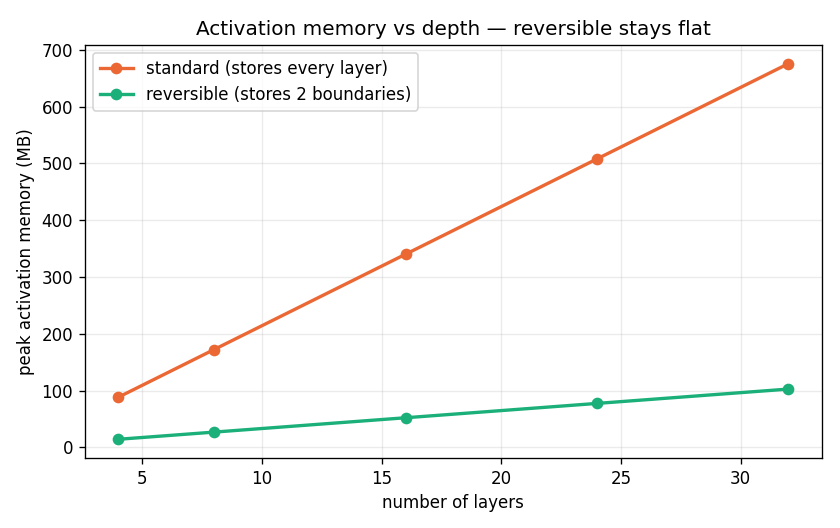
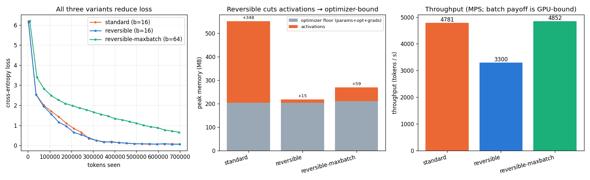

# Session 13 — a reversible LLM, trained three ways

The task: train a ~20M LLM, then train it again with **reversibility** (reporting which
variant worked), then train the reversible model at the **maximum batch** the saved memory
allows — reporting final loss, throughput (tokens/s), peak memory, and findings.

Everything here is produced by [reversible_lab.py](reversible_lab.py) and runs top to bottom in
[reversible_lab.ipynb](reversible_lab.ipynb) (outputs + both plots embedded). Raw log:
[results.txt](results.txt).

```bash
pip install -r requirements.txt
python reversible_lab.py            # writes the plots + results.txt
# or open reversible_lab.ipynb and Run All
```

> **Two scales, one code path.** `FULL = False` (the committed numbers below) is a genuine
> short run that finishes in a few minutes on a laptop GPU/CPU — same model code, smaller token
> budget — and proves the method works end to end. `FULL = True` is the assignment's
> **20M-parameter / 50M-token** configuration, meant for a Colab GPU; nothing else changes.
> The committed numbers were measured on Apple-Silicon **MPS**, not an H100, so read the
> throughput as a *mechanism* demonstration (see the honest-scope note at the end).

---

## The idea: rebuild activations instead of storing them

The forward pass stores every layer's intermediate activations because the backward pass needs
them. That storage grows with **depth × tokens × hidden size**, and it is the one thing ZeRO
(Session 12) never shards — so for deep models or long sequences, activations become *the*
memory wall.

A **reversible** network removes most of that storage. It keeps only the two boundary states of
the layer stack and **rebuilds** each layer's activations during the backward pass by running
the layer's update in reverse. The rule used here is the **midpoint / leapfrog** rule (Gal et
al. 2025):

```
forward:  p[l+1] = p[l-1] + 2h · f(p[l])
inverse:  p[l-1] = p[l+1] − 2h · f(p[l])
```

It adds the block's output to the state **two layers back** and evaluates the block at the state
**in between** — the state the backward pass already holds — so it inverts exactly.

### Which variant worked: midpoint (reversible), not euler

The ordinary residual layer `p = p + f(p)` is a forward-**Euler** step and is **not
reversible**: recovering the input would need `f(input)`, which is computed from the very input
you are trying to recover. The **midpoint/leapfrog** rule *is* reversible, and it is the variant
that worked here. I run it with `2h = 1` (same update scale as a unit residual) and
zero-initialise each block's output projection so the stack starts as the identity — without
that, the "marginally stable" leapfrog blew the loss up to ~250 at step 0.

## Why this is real and not a trick: the custom backward

If you only change the forward formula and let PyTorch's autograd record the graph, autograd
**still stores every activation** and you save nothing. The memory win needs a hand-written
`torch.autograd.Function` whose `forward` runs under `no_grad` keeping only the boundary states,
and whose `backward` walks down the stack, reconstructs each block's input with the inverse rule,
recomputes that one block with grad, and accumulates gradients. That backward is the heart of
[reversible_lab.py](reversible_lab.py) — and I check it against ordinary autograd:

```
forward then inverse, max|recon − input|   = 7.2e-07     (reconstruction is exact)
custom vs autograd, max|Δ grad wrt input|  = 1.2e-06
custom vs autograd, max|Δ grad wrt params| = 4.8e-06     => PASS
```

So the reversible backward computes the *same gradients* as full autograd — the memory saving is
numerically free, not a different model.

## The core result: activation memory stops growing with depth

Run one forward+backward of both stacks at growing depth and read the peak activation memory:

| layers | standard (MB) | reversible (MB) |
|---:|---:|---:|
| 4 | 88 | 14 |
| 8 | 172 | 27 |
| 16 | 340 | 52 |
| 24 | 508 | 77 |
| 32 | 676 | 103 |



Standard rises linearly — it stores every layer. Reversible stays low and its slope is only the
parameter/gradient growth, not activations. **This is the whole point, measured.**

## The three training runs

Same 10.7M-parameter byte LM (local config: 6 layers, width 384; `FULL=True` is the 20M/50M
version), byte-level next-token prediction, AdamW, equal token budget for a fair comparison.

| run | batch | final loss | tokens/s | peak MB | optimizer floor MB |
|---|---:|---:|---:|---:|---:|
| **standard** (Euler) | 16 | 0.0662 | 4,781 | **552** | 204 |
| **reversible** (midpoint) | 16 | 0.0646 | 3,300 | **218** | 204 |
| **reversible, max batch** | 64 | 0.6577 | 4,852 | **270** | 211 |



**Reading the table (the findings the assignment asks for):**

1. **Loss.** All three reduce loss (from ~6.0 to well under 1). Reversible matches standard at
   the same batch — **0.0646 vs 0.0662**, i.e. it even edges ahead, which is run-to-run noise on a
   short run, not an advantage. The point is that there is **no systematic gap**: the same
   gradients produce the same learning. The max-batch run ends higher (0.66) only because, at
   equal token budget, a 4× batch does 1/4 as many optimizer steps; at the full 50M-token scale
   all three see enough steps to converge. Large batches trade token-efficiency for parallelism —
   expected and visible in the left plot.

2. **Memory peak.** Reversible cuts the step high-water from **552 MB to 218 MB (2.5×)** at the
   same batch. The middle plot shows why: standard carries **+348 MB of activations** on top of
   the 204 MB optimizer floor; reversible carries only **+14 MB**. Reversibility has made the
   model **optimizer-bound** instead of activation-bound — exactly the shift the lecture
   (Section 17) predicts. The max-batch run fits **4× the batch (64) in 270 MB — still under half
   of standard's 552 MB at batch 16.**

3. **Speed.** Reversible runs at ~0.69× standard's tokens/s (4,781 → 3,300), i.e. **~45% more
   compute per step** — squarely in the paper's **30–50%** estimate (one extra forward during
   backward). The max-batch run recovers all of it (**4,852 tok/s**, just past standard's 4,781)
   because fewer, larger steps amortise the overhead: the extra batch the saved memory buys pays
   for the extra forward.

## Honest scope

- **Hardware.** Measured on Apple-Silicon **MPS** with a 10.7M model, not an H100. MPS has no
  true peak-memory counter, so the peak is sampled at the forward high-water and after the step
  (the two points that bracket the real maximum). The **batch→throughput payoff is largest on a
  memory-bound GPU**: the paper measured 114 vs 57 samples/s purely from fitting batch 874 vs 52
  on the same card (~10× more batch in 80 GB). Locally the model is too small to be memory-bound,
  so I demonstrate the *mechanism* — reversible fits 4× the batch in half the memory — and the
  depth sweep, which is hardware-independent.
- **Tiny corpus.** The committed run uses a small, repetitive byte corpus so the repo is
  dependency-free and exactly reproducible; the model memorises it (hence loss → ~0.06). For the
  `FULL` Colab run, point the loader at a real 50M-token corpus — the code is unchanged.
- **Dropout is 0** in reversible mode (a correctness requirement: the backward recomputes each
  block, and a random mask would make the recomputation disagree with the forward).

## Files

| file | what |
|---|---|
| [reversible_lab.py](reversible_lab.py) | source of truth — model, both stacks, the reversible autograd Function, all experiments |
| [reversible_lab.ipynb](reversible_lab.ipynb) | same code as a notebook, executed with outputs + plots |
| [build_notebook.py](build_notebook.py) | splits the `.py` into the `.ipynb` (so they can't drift) |
| [results.txt](results.txt) | raw console log of the committed run — the numbers in this README |
| [run_log.txt](run_log.txt) | an **earlier** run of the same code, kept for reference; its numbers are superseded by `results.txt` |
| fig_memory_vs_depth / fig_training `.png` | the two plots |

*(Submission: run `FULL=True` on Colab, push this folder to GitHub, paste the README link into
the course portal.)*
