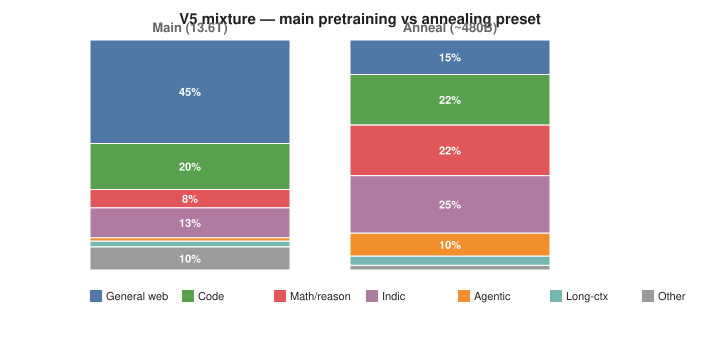
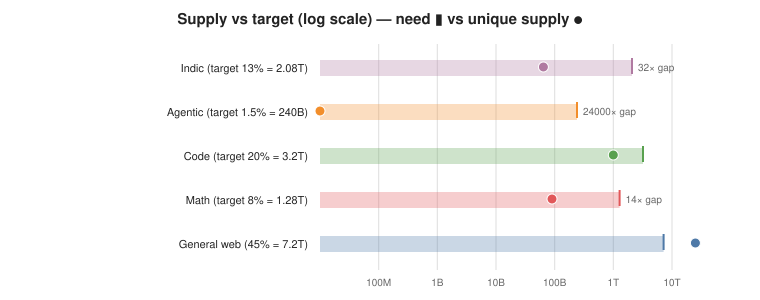
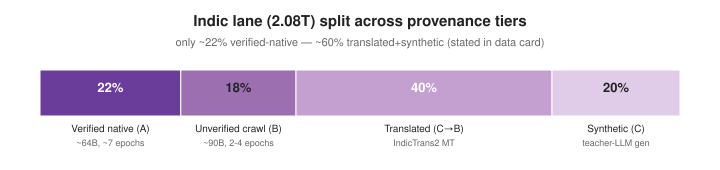
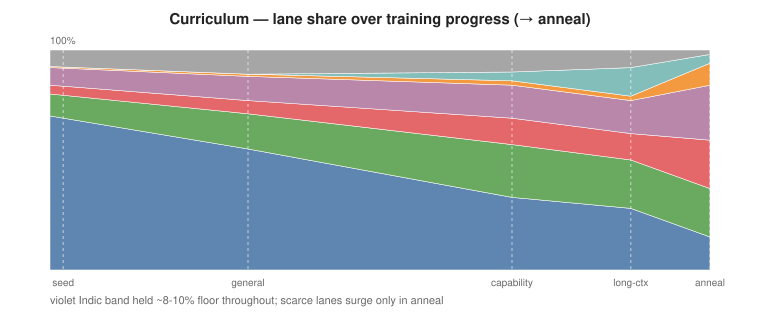
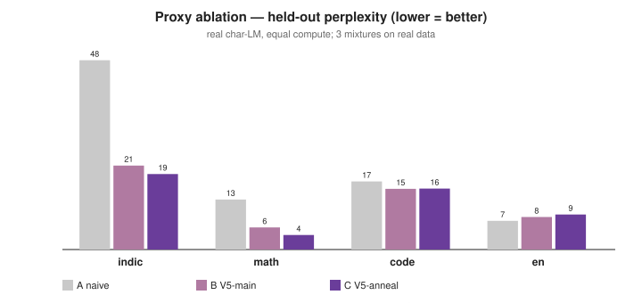

# Session 5 — Data Mixture & Curriculum for V5 ("Bharat")

**Submission artifact.** A mixture-and-curriculum plan for an India-first ~40B model,
composed backward from benchmarks, sized honestly against real dataset supply, protected
by an always-on floor and an anneal reserve, ordered by a warmup-banded curriculum, and
**tested with a real proxy ablation** whose numbers are reported below.

> **The graded specification:** [`plan/mixture-and-curriculum-v5.md`](plan/mixture-and-curriculum-v5.md)
> **How it was researched & built (read this for the full story):** [`WALKTHROUGH.md`](WALKTHROUGH.md)
> **Evidence:** [`research/`](research/) (dossiers) · [`proxy/`](proxy/) (the ablation, runnable)

---

## The one-paragraph thesis

The mixture is the model. Against a fixed **16T-token** budget we compose backward from the
benchmarks we intend to win, then **shrink any lane the real supply cannot honestly fill**.
Two lanes are structurally scarce: **Indic** (only **64B** verified-native tokens exist in
the open commons) and **agentic** (only **~10k** real multi-step trajectories exist). So we
size Indic at an honest **13%** with an explicit four-tier provenance split, treat agentic
as **~90% synthesized**, protect Indic/agentic/reasoning behind a **15.5% always-on floor**
the OPUS selector cannot cross, **reserve** the best Tier-A data for the **anneal**, and
order everything with a curriculum whose transitions are blended over warmup bands (V4's
150× gradient-spike lesson).

---

## 1. The mixture — main pretraining vs annealing



| Lane | Main share | Tokens | Anneal share | Benchmarks it wins |
|---|---:|---:|---:|---|
| General web | 45% | 7.2T | 15% | world knowledge, fluency |
| Code | 20% | 3.2T | 22% | HumanEval, MBPP, LiveCodeBench, SWE-bench |
| Math / reasoning | 8% | 1.28T | 22% | GSM8K, MATH, AIME, GPQA |
| **Indic** | 13% | 2.08T | 25% | MILU, IndicMMLU-Pro, IndicGenBench, IndicQA, IndQA |
| **Agentic** | 1.5% | 240B | 10% | SWE-bench, BFCL, τ-bench, Terminal-Bench |
| Long-context | 2.5% | 400B | 4% | 128K+ context |
| Other | 10% | 1.6T | 2% | knowledge depth |

Each number is defended in [`research/03-mixture-derivation.md`](research/03-mixture-derivation.md)
and tied to its benchmark in [`research/01-benchmark-map.md`](research/01-benchmark-map.md).

## 2. Honest supply — why the scarce lanes drive everything



The whole session exists to prevent handing a big share to a lane with no data behind it.
Verified-native Indic is **~32× short** of even a 13% target; real agentic trajectories are
**~1000×** short in samples. Full inventory with sources:
[`research/02-dataset-inventory.md`](research/02-dataset-inventory.md).

## 3. The Indic lane — split across four provenance tiers (no single headline number)



**Data-card honesty:** ~22% verified-native, ~18% crawl, ~40% machine-translated
(IndicTrans2), ~20% synthetic. Real unique ≈ 154B; ~60% of the lane is translated+synthetic.
We do **not** claim 25% native — the world holds 64B native tokens.

## 4. Protected floor + anneal reserve

| Protected (OPUS may not cross) | Floor/batch | | Anneal reserve (held back) |
|---|---:|---|---|
| Indic | 10% | | best ~15B verified-native Indic |
| Agentic | 1.5% | | **all ~10k real agentic trajectories** |
| Reasoning | 4% | | longest checker-passed reasoning traces |
| **Total floor** | **15.5%** | | SWE-Gym-verified code edits (~300–400B total) |

OPUS selects aggressively (~40% kept, ~6× effective tokens in V4) over the remaining ~84.5%.
SWE-Gym's 491 real trajectories alone gave **+14% on SWE-bench Verified** — the reserve is
disproportionately valuable and cannot be recovered once spent early.

## 5. Curriculum, difficulty & reasoning-length bands



Stages: seed → general → capability → long-context → anneal, every transition **blended over
a warmup band of several billion tokens** (no hard mixture steps; embeddings not frozen during
Indic-share increases). Difficulty ladder L0→L4 and reasoning bands Low→Ultra, each with a
concrete example, in [`plan/mixture-and-curriculum-v5.md`](plan/mixture-and-curriculum-v5.md) §8.

## 6. The plan as a hypothesis — and the proxy that tested it



I actually ran a scaled-down ablation (real char-LM, real data, 3 mixtures, equal compute):

| Lane | A naive web-heavy | B **V5-main** | C V5-anneal |
|---|---:|---:|---:|
| Indic ppl | 48.3 | **21.4** (−21%) | 19.3 (−24%) |
| math ppl | 12.8 | **5.6** (−32%) | 3.7 (−49%) |
| code ppl | 17.4 | **15.5** (−4%) | 15.5 (−4%) |
| en ppl | **7.3** | 8.3 (+6%) | 8.9 (+10%) |

**Direction confirmed strongly** — protecting scarce lanes more than halves Indic perplexity.
The strict "≤2% English cost" sub-claim was **refuted at proxy scale** — a real trade-off the
proxy usefully surfaced (and which the tiny model *overstates*; see
[`proxy/README.md`](proxy/README.md)). The magnitude gate remains the 1B/3B run. *A data
decision is a hypothesis until a cheap experiment tests it — and this one refined the
hypothesis rather than rubber-stamping it.*

```bash
# reproduce the proxy (uses Session 4's numpy venv; ~6s)
cd proxy && ../../session-4/.venv/bin/python3 data_prep.py && ../../session-4/.venv/bin/python3 train.py
```

## 7. Strategic bet — the Indic × agentic intersection

No mature Indic coding/agentic benchmark exists (BFCL-Hi is unverified MT; Indic LLM-Arena
agentic is roadmap-only). Bharat's synthetic budget builds **Indic BFCL / Indic τ-style /
Indic-instruction-code** — the same loss maps as English agentic, with Indic/Hinglish
prompts — turning two lanes into one measurable, differentiated lead.

---

## Repository map

| Path | What |
|---|---|
| [`plan/mixture-and-curriculum-v5.md`](plan/mixture-and-curriculum-v5.md) | **the graded specification** |
| [`WALKTHROUGH.md`](WALKTHROUGH.md) | continuous narrative — how everything was researched & built |
| [`research/01-benchmark-map.md`](research/01-benchmark-map.md) | benchmark → training-data format → loss shape → stage |
| [`research/02-dataset-inventory.md`](research/02-dataset-inventory.md) | real datasets: samples + tokens + license + tier + supply verdicts |
| [`research/03-mixture-derivation.md`](research/03-mixture-derivation.md) | every % defended with supply arithmetic |
| [`proxy/`](proxy/) | the runnable ablation + honest results & limitations |
| [`assets/`](assets/) | the static SVG charts + their generator |

*Builds on Session 3 (India-first strategy, tokenizer, first-draft mix) and Session 4 (the
real cleaned corpus + provenance manifest that this plan points at as supply).*
