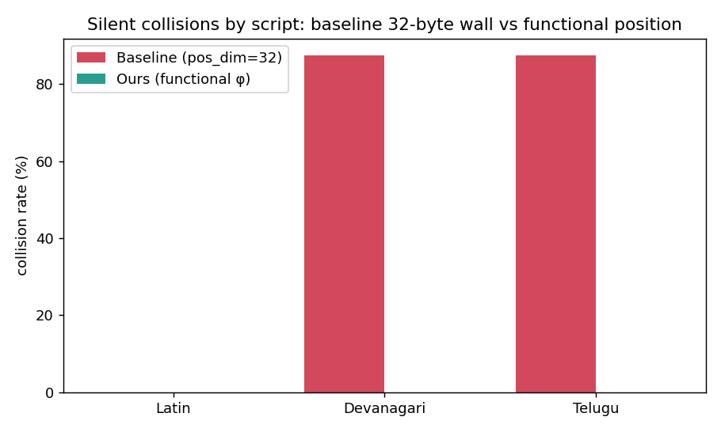
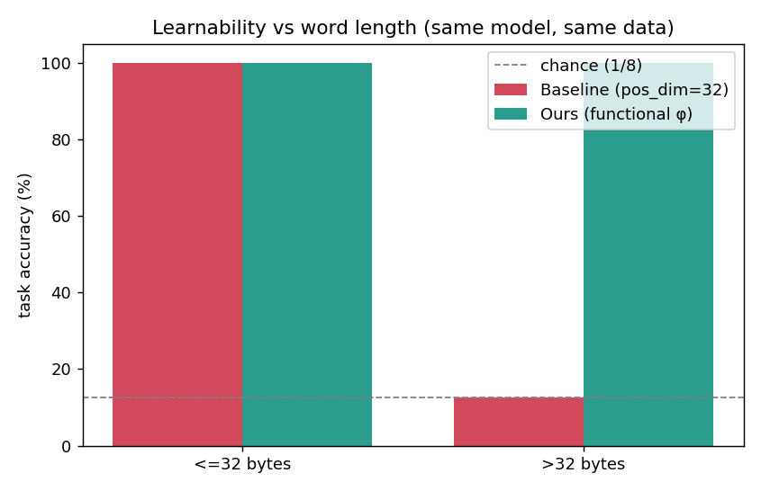

# Dynamic-Length Kronecker Embeddings — Functional Position

**Session 7 · Problem #3** — *"Today Kronecker is limited to 32 positions for every word … how can it be dynamic and not force us to crop a word?"*

> **One-line result:** replacing the Kronecker codec's discrete 32-slot byte-position factor with a **continuous position function φ(p)** removes the 32-byte wall entirely, eliminates silent collisions on long (mostly Indic) words, and does it with **half the projection parameters** — proven by training the *same* transformer on both codecs.

---

## 1. The problem

The course's Kronecker embedding (notes §7–8) builds a token's vector from its UTF-8 bytes instead of storing a row per token:

```
kappa(b) = (1/sqrt(L)) * vec( sum_p  onehot_256(byte_p) (x) onehot_32(pos_p) )
```

A **256 × 32 grid**: 256 byte values × **32 byte positions**. This is beautiful — the parameter count has no `V` in it, so a 500K vocab costs the same as a 30K one. But the 32 columns are a hard window:

- **Only the first 32 bytes of a token are ever encoded.** Bytes past position 32 are dropped.
- Indic scripts cost ~3 bytes/char (a conjunct like क्ष = 9 bytes). A word with a few conjuncts exhausts the 32-byte budget mid-word.
- The failure is **silent**: two different words that agree on their first 32 bytes get the **identical code**, hence the identical embedding, *forever*. The projection is never shown a difference, so it can never learn one.

The lecture's own example: **अंतर्राष्ट्रीयकरण** (51 bytes) and **अंतर्राष्ट्रीयता** (48 bytes) — different words, identical code.

## 2. The solution — functional-position Kronecker

Keep everything that makes Kronecker good (byte-built, vocabulary-free, one shared projection). Change **one factor**: replace the discrete `onehot_32(p)` with a **continuous sinusoidal position function** φ(p) ∈ ℝᴷ defined for *every* p:

```
kappa(b) = (1/sqrt(L)) * vec( sum_p  onehot_256(byte_p) (x) phi(p) )

phi(p)_2i   = sin(p / base^(2i/K))
phi(p)_2i+1 = cos(p / base^(2i/K))
```

The code row for byte value `v` becomes `sum over positions p where byte_p == v of phi(p)`.

| property | baseline | ours |
|---|---|---|
| max word length | **32 bytes (hard wall)** | **unbounded** — φ(p) exists for all p |
| short-word waste | full 32 columns always | K columns, `K < 32` |
| code dimension | 256 × 32 = **8192** | 256 × 16 = **4096** |
| projection params (d=128) | 1,048,576 | **524,288** |
| trainable codec params | 0 | 0 |

This is not an arbitrary trick — it is the lecture's *own* prescription (notes §11: *"stop storing position and start computing it"*), applied to the **byte-position** factor instead of the sequence-position factor.

## 3. How we prove it

Run everything with one command:

```bash
python -m venv .venv && source .venv/bin/activate
pip install -r requirements.txt
python run_demo.py
```

### Proof 1 — the named pair (`collision_test.py`)
| | bytes | baseline cosine | ours cosine | collision? |
|---|---|---|---|---|
| अंतर्राष्ट्रीयकरण vs अंतर्राष्ट्रीयता | 51 / 48 | **1.000000** | 0.9921 | baseline **yes**, ours **no** |

### Proof 2 — collision sweep by script (inflectional families)
24 distinct words per script (long stem × 8 suffixes). A collision = distinct words forced to share one code.

| script | words | baseline collisions | ours collisions |
|---|---|---|---|
| Latin (1 B/char) | 24 | **0** | 0 |
| Devanagari | 24 | **21** | **0** |
| Telugu | 24 | **21** | **0** |

Latin is fine under the baseline (English has byte headroom — faithful to the lecture). Indic families collapse: all 8 suffixed forms of a stem map to **one** code.



### Proof 3 & 4 — train a transformer (`train.py`)
A tiny causal Transformer predicts a word's suffix class (0–7) — the distinguishing byte lives *past* position 32 for long words. **Identical model, data, seed, optimizer; only the codec differs.**

| codec | overall acc | PPL | acc ≤32 B | **acc >32 B** | projection params |
|---|---|---|---|---|---|
| baseline (pos_dim=32) | 56.25% | 2.85 | 100% | **12.5% (= chance 1/8)** | 1,048,576 |
| **ours (functional, K=16)** | **100%** | **1.00** | **100%** | **100%** | **524,288** |

The baseline hits **exactly chance** on long words: the model physically cannot assign 8 labels to 8 identical input vectors. Ours learns them perfectly — with **half** the parameters.



## 4. Files

| file | what it is |
|---|---|
| `embeddings.py` | both codecs + shared-projection `KroneckerEmbedding` module |
| `model.py` | the tiny causal Transformer (shared across both runs) |
| `collision_test.py` | proofs 1 & 2 → `collision_report.json` |
| `train.py` | proofs 3 & 4 → `training_report.json` |
| `run_demo.py` | one command, runs all four proofs |
| `../assets/*.png` | generated charts |

## 5. Honest limitations

- **Cosine on the named pair is 0.9921, not low** — the words genuinely share most of their bytes, so high similarity is *correct*; what matters is it is **not exactly 1.0** (no silent collision). Full separability is what the trained model confirms.
- The task is a controlled diagnostic (suffix classification), not a full LM pretraining run — appropriate for a proof-of-concept at this scale, and explicitly what the assignment invites ("a small transformer model").
- φ(p) is fixed sinusoidal. A learned or RoPE-style φ is the natural Session-8 follow-up (the notes point there directly), and whether to *decay* these factors is flagged as an open ablation in the Session 11 notes.
